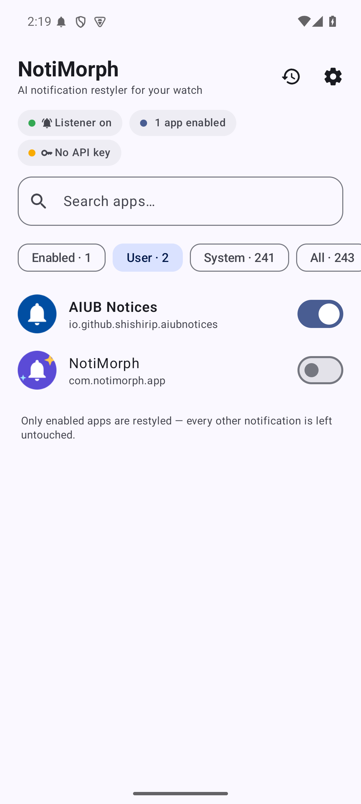
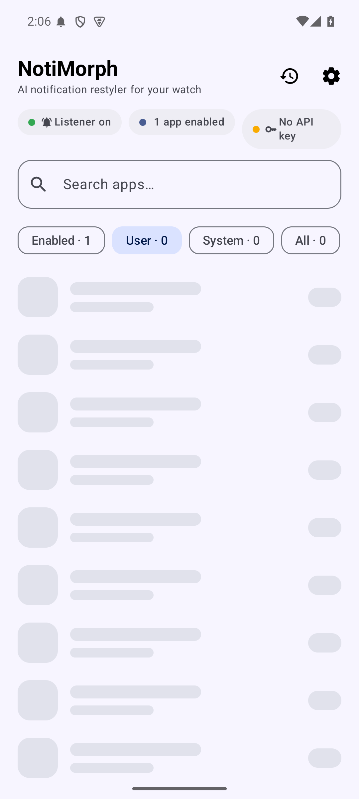
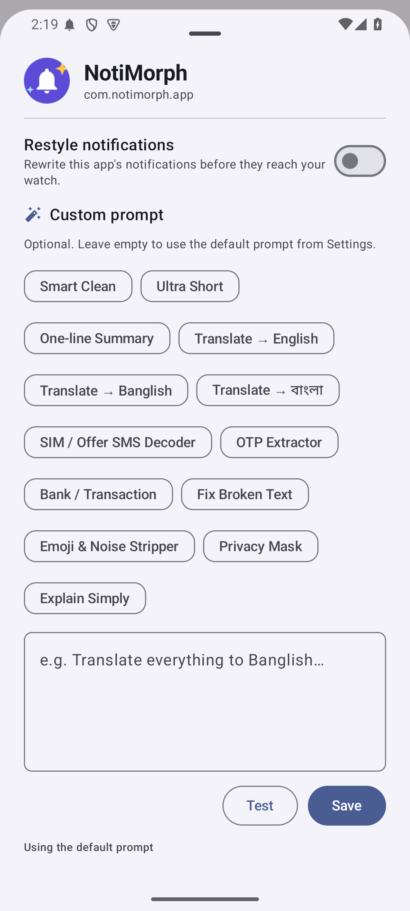
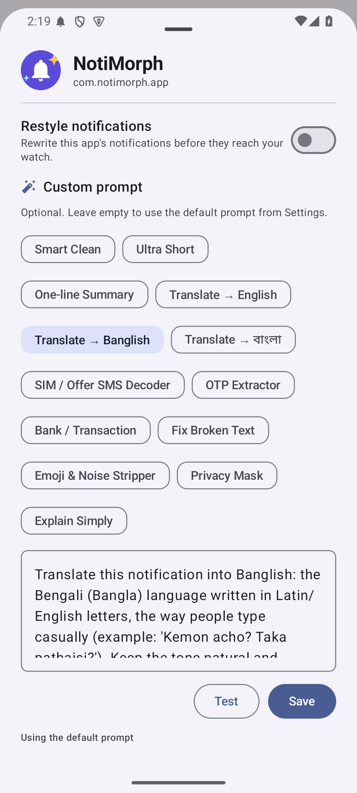
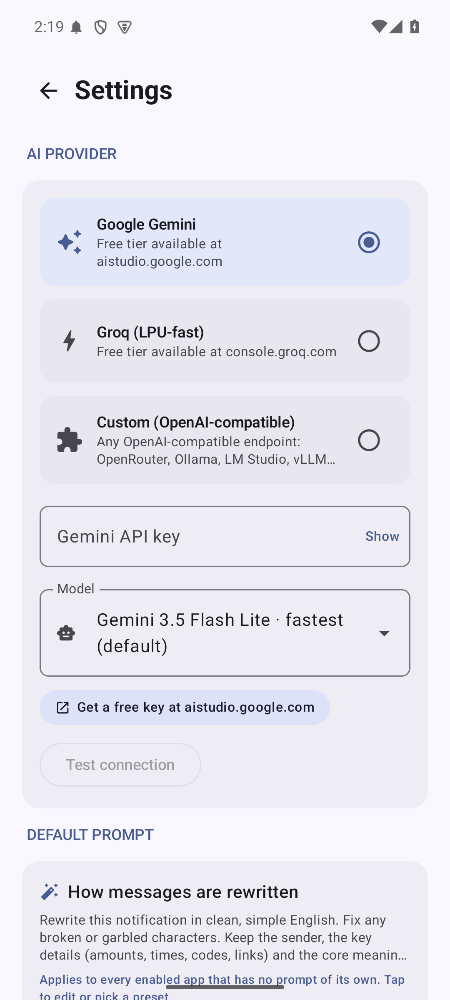
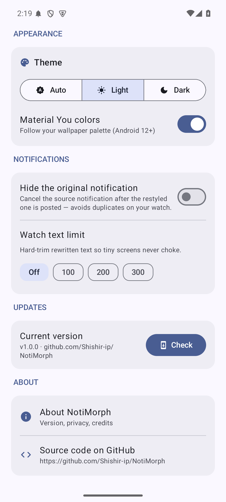
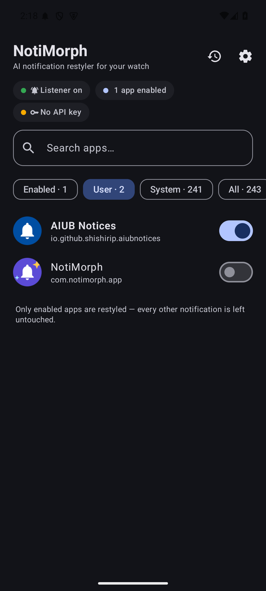
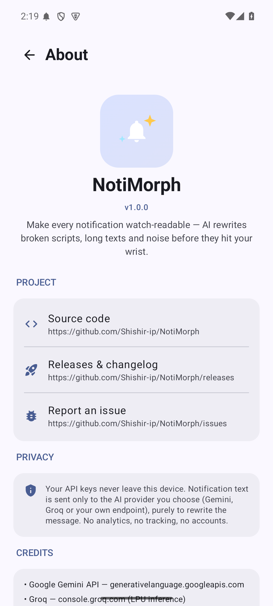
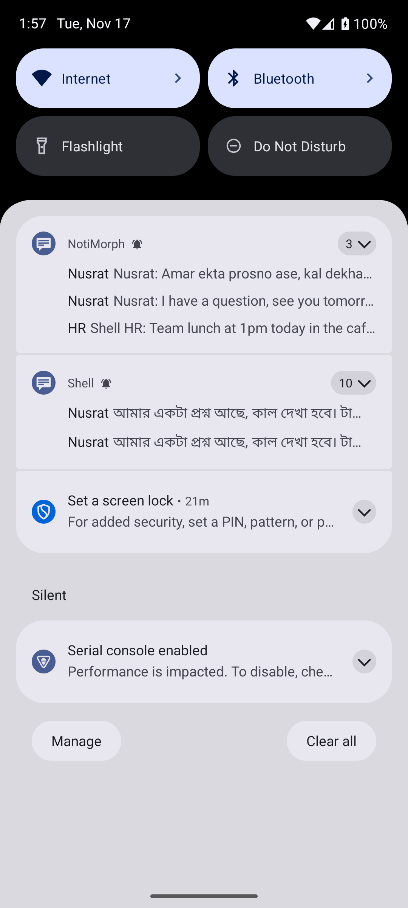

<div align="center">

# 🔔 NotiMorph

**AI-powered notification restyler for Android — make every notification watch-readable.**

Fixes garbled Bangla/Unicode text, over-long messages, emoji noise and operator SMS gibberish
**before** they reach your smartwatch, smart band or e-ink watchface.

[](https://github.com/Shishir-ip/NotiMorph/releases)
[](https://github.com/Shishir-ip/NotiMorph/releases)
[](https://kotlinlang.org)
[](LICENSE)

[Download the latest APK](https://github.com/Shishir-ip/NotiMorph/releases/latest) · [Report a bug](https://github.com/Shishir-ip/NotiMorph/issues)

</div>

---

## The problem

Smartwatches and smart bands mirror your phone notifications, but they often show:

- ⬛⬛⬛ **boxes / tofu** when the message is in a language the watch font doesn't support (Bangla, Hindi, Tamil, Urdu…)
- **truncated text** when the message is longer than the tiny screen
- **emoji soup** and marketing fluff from operator/service SMS
- **unreadable codes** — local-language promo SMS with bundles, offers and activation codes

## The fix

NotiMorph sits between your apps and your watch. When a notification arrives from an app you enabled,
it sends the text to an AI provider of your choice and posts a **brand-new notification** — same app
icon, same color, same tap-to-open behavior — with a rewritten, watch-friendly body.

```
WhatsApp ──▶ NotiMorph ──▶ Gemini / Groq / your AI ──▶ clean rewritten notification ──▶ your watch
```

> _"তোমার অর্ডার #৪৫২১ …" with boxes_ ➜ `Order #4521 is ready for delivery — OTP 8812 · Track: https://x.co/4521`

## ✨ Features

- **3 AI providers, 1 toggle away**
  - **Google Gemini** — `gemini-3.5-flash-lite` (default) / `gemini-3.6-flash` — *free tier at [aistudio.google.com](https://aistudio.google.com/apikey)*
  - **Groq** — `openai/gpt-oss-120b` (default) / `qwen/qwen3.6-27b` — *free tier at [console.groq.com](https://console.groq.com/keys)*
  - **Custom OpenAI-compatible endpoint** — OpenRouter, Ollama, LM Studio, vLLM, LiteLLM, anything that speaks `/chat/completions`
- **Per-app control** — enable/disable each app from a searchable, categorized list (Enabled · User · System · All) with a shimmer loading animation
- **Custom prompt per app** — give WhatsApp one behavior, your bank another; 13 built-in presets as a starting point
- **Built-in presets** — Smart Clean, Ultra Short, Translate → English / **Banglish** / বাংলা, SIM & Offer SMS Decoder, OTP Extractor, Bank/Transaction formatter, Broken-text repair, Emoji stripper, Privacy mask, Explain Simply
- **Speed-optimized** — HTTP/2 keep-alive connection pool, endpoint pre-warming, duplicate suppression, result replay cache, bounded concurrency → typically ~1–3 s per notification
- **Hide original** (optional) — cancel the source notification so your watch doesn't show it twice
- **Watch text limit** — hard-trim rewritten text to 100/200/300 chars for tiny screens
- **History** — every rewrite logged *before → after* so you can audit the AI
- **Test connection** — one tap verifies your key + model against a real sample message
- **In-app updates** — checks GitHub Releases, shows the changelog, downloads the APK with a progress bar and installs it
- **Beautiful UI** — Material 3, Material You dynamic color, Auto/Light/Dark theme, smooth animations everywhere
- **Private** — keys stay on-device, no analytics, no accounts, fully open source

## 📸 Screenshots

| Home | Loading animation | App settings | 13 prompt presets |
|------|-------------------|--------------|-------------------|
|  |  |  |  |

| Provider setup | Appearance & behavior | Dark mode | About |
|----------------|-----------------------|-----------|-------|
|  |  |  |  |

**Live proof** — a Bengali WhatsApp-style message rewritten on the fly (per-app *Translate → Banglish* prompt,
947 ms end-to-end on the default Gemini model):



## 🚀 Getting started

1. **Install** the [latest release APK](https://github.com/Shishir-ip/NotiMorph/releases/latest)
2. **Grant notification access** — NotiMorph will guide you; it's the Android *Notification listener* permission
3. **Pick a provider** and paste an API key
   | Provider | Free tier | Get a key |
   |---|---|---|
   | Google Gemini | ✅ Generous free tier | [aistudio.google.com/apikey](https://aistudio.google.com/apikey) |
   | Groq | ✅ Free tier | [console.groq.com/keys](https://console.groq.com/keys) |
   | Custom (OpenAI-compatible) | depends on endpoint | e.g. [openrouter.ai](https://openrouter.ai/keys) |
4. **Tap "Test connection"** to verify
5. **Enable your apps** — WhatsApp, Messenger, SMS, banking apps…
6. Send a test message and enjoy readable notifications on your watch ⌚

## 🧠 How the AI call is optimized

| Technique | Effect |
|---|---|
| HTTP/2 + keep-alive pool | Skips DNS + TLS on repeat calls (~200–400 ms) |
| Endpoint pre-warm on app start + periodic re-warm | Every notification arrives at a hot connection |
| Compact prompt + `maxOutputTokens=320`, `temperature=0.2` | Fast, deterministic rewrites |
| No hidden "thinking" on Flash-Lite; `thinkingBudget=1` on thinking models | Cuts seconds of hidden reasoning |
| `reasoning_effort: low` on Groq GPT-OSS | Skips heavy reasoning passes |
| Duplicate suppression (5 s window) | Apps reposting the same payload don't cost extra calls |
| Prompt-bound replay cache (10 min TTL) | Identical raw notification → instant repost, zero API calls — and any prompt change takes effect immediately |
| One transparent retry | Survives transient 429/5xx/network blips |
| Bounded concurrency (4) | Notification bursts never overload the network |
| Graceful fallback | On any API error the original text is kept, never lost |

Typical end-to-end latency with the default Gemini model: **~0.7–1.5 s** after the first call.

## 🛠️ Build from source

```bash
git clone https://github.com/Shishir-ip/NotiMorph.git
cd NotiMorph
# open in Android Studio, or:
./gradlew assembleDebug          # debug APK
./gradlew assembleRelease        # needs keystore.properties (see below)
```

To sign your own release build, create a `keystore.properties` in the project root:

```properties
storeFile=keystore/notimorph.jks
keyAlias=notimorph
storePassword=your-password
keyPassword=your-password
```

…generate a keystore with:

```bash
keytool -genkeypair -keystore keystore/notimorph.jks -alias notimorph \
  -keyalg RSA -keysize 2048 -validity 10950
```

## ❓ FAQ

**Will it work with my Mi Band / Galaxy Watch / Amazfit / Pixel Watch?**
Yes — if your watch mirrors Android notifications (all of them do), it shows NotiMorph's rewritten
notification instead of the original.

**Do I need root?** No. Only the standard *Notification access* permission.

**Does it drain battery?** Negligible — the AI call happens only when a notification from an enabled
app arrives, and the network connection is pooled and pre-warmed.

**Does the watch still show the original notification?**
Yes, both appear by default (safe behavior). Turn on **Hide the original** in Settings if you want
only the restyled one — recommended for watch use.

**Why isn't my OTP/bank notification rewritten on Android 15+?**
Android 15 deliberately hides OTP codes and banking amounts from side-loaded notification-listener
apps — it delivers the text *"Sensitive notification content hidden"* instead of the real message
([platform change](https://www.androidauthority.com/android-15-sensitive-notifications-3416414),
[developer discussion](https://www.reddit.com/r/androiddev/comments/1g7tdld/android_15_breaks_notification_listeners/)).
NotiMorph detects this and leaves the original untouched instead of posting garbage. Non-sensitive
notifications (chats, news, social) are unaffected. To get full OTP coverage on Android 15+, turn off
**Enhanced/Sensitive notifications** in the system notification settings (NotiMorph shows a one-tap
hint for this). Android 14 and below are unaffected.

**My language isn't Bengali — still useful?** Absolutely. Any language works: translation presets,
OTP extraction, summarization and noise removal are language-agnostic.

## 🔒 Privacy & security

- API keys are stored in Android **DataStore**, on-device only
- Notification content is transmitted **only** to the AI provider you configure, only to rewrite text
- No third-party servers, no analytics SDKs, no tracking
- 100% open source — audit every line

## 📄 License

[MIT](LICENSE) © [Shishir](https://github.com/Shishir-ip)

> ⚠️ Not affiliated with Google, Groq or any watch manufacturer. Names and trademarks belong to their owners.

<div align="center">

**⭐ Star this repo if NotiMorph saved your eyes from tofu boxes!**

`android notification smartwatch wearables ai gemini groq bangla translation kotlin jetpack-compose notification-listener mi-band galaxy-watch assistant`

</div>
